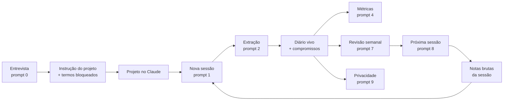

```text
██╗     ██╗██╗     ██╗ █████╗ ██╗
██║     ██║██║     ██║██╔══██╗██║
██║     ██║██║     ██║███████║██║
██║     ██║██║     ██║██╔══██║██║
███████╗██║███████╗██║██║  ██║██║
╚══════╝╚═╝╚══════╝╚═╝╚═╝  ╚═╝╚═╝

   a mentoria falou. O Claude anotou. Sua carreira fez o resto.
```

<p align="center">
  <b>Porque "eu lembro depois" não é estratégia de carreira.</b>
</p>

<p align="center">
  
  
  
  
  
</p>

> **Projeto não oficial, feito pela comunidade.** O LiliAI é um kit descontraído. Não tem vínculo com nenhum programa de mentoria, empresa ou mentor. Use com as suas próprias notas e siga a política da sua empresa para ferramentas de IA.

---

## O que é isso?

Você assiste a uma sessão de mentoria. Concorda com a cabeça. Anota três palavras no caderno. Duas semanas depois, só lembra de "algo sobre visibilidade".

O **LiliAI** é um kit de prompts e modelos que transforma cada sessão de mentoria em:

- **notas** limpas (o que foi dito),
- **lições e ações** extraídas, com responsável, prazo e status,
- um quadro de **compromissos** (o que você prometeu, a quem, até quando),
- **métricas macro** (sessões, lições, ações por status),
- e, quando quiser, um **dossiê** que mostra o seu progresso para você e para a sua mentoria.

**Tudo acontece numa conversa com o Claude.** Não tem terminal, não tem comando, não tem nada para instalar. Você cola um prompt, o Claude trabalha. O contexto que torna o Claude útil vem de uma entrevista curta, feita também pelo Claude, e fica guardado no seu Projeto.

## Recursos

| | Recurso | Por que importa |
|---|---|---|
| 1 | **Onboarding por entrevista** (36 perguntas, 10 blocos) | Seu Projeto no Claude conhece você, sua meta e seus limites desde o primeiro dia |
| 2 | **Dez prompts prontos** | Da entrevista à revisão semanal, em `prompts/` |
| 3 | **Um diário vivo** | Um único arquivo guarda sessões, lições, ações e compromissos |
| 4 | **Métricas por prompt** | O Claude conta e mostra cada item contado, para você conferir |
| 5 | **Privacidade por padrão** | Seus dados ficam no seu Projeto, nunca neste repositório |
| 6 | **Funciona em qualquer lugar** | Mac, Windows, Linux, tablet ou celular, onde o Claude funcionar |
| 7 | **Status quo e níveis de maturidade** | O `STATUS-QUO.md` mostra onde você está e qual é o próximo nível |

## O que você precisa

Uma conta no Claude com **Projetos**. Só isso.

## Começando

Cada passo abaixo tem uma tela. **Todas as telas são ilustrações** com dados fictícios. O texto do Claude no seu caso será diferente.

### Passo 1. Pegue o kit

Neste repositório, clique em **Code > Download ZIP** e descompacte. Você vai usar a pasta `prompts/`, a pasta `modelos/` e o arquivo `onboarding/questionario.md`.

### Passo 2. Crie um Projeto no Claude

No Claude, abra **Projetos > Novo projeto**. Dê o nome da sua meta, por exemplo "Minha promoção". Deixe as instruções vazias por enquanto.


### Passo 3. Envie o kit para o conhecimento do Projeto

Em **Conhecimento do projeto**, adicione os arquivos de `prompts/`, `modelos/` e `onboarding/questionario.md`. Assim o Claude consulta o kit em qualquer conversa do Projeto.


### Passo 4. Faça a entrevista

Abra uma conversa no Projeto e cole o prompt de `prompts/00-entrevista.md`. O Claude pergunta um bloco por vez. Responda por id. Digite `?` depois de um id para ver um exemplo e o motivo da pergunta.


### Passo 5. Receba a instrução do projeto

No final, o Claude entrega três itens: o resumo do seu contexto, a **instrução do projeto** e a lista de **termos bloqueados**. Salve o resumo no conhecimento do Projeto.


### Passo 6. Cole a instrução no Projeto

Copie a instrução para **Configurações do projeto > Instruções**. É aqui que o seu Claude deixa de ser genérico e passa a ser seu.


### Passo 7. Registre a primeira sessão

Depois de cada sessão, abra uma conversa no Projeto, cole as notas brutas e use `prompts/01-nova-sessao.md`. O Claude organiza o texto e abre a sessão no seu **diário**.


### Passo 8. Extraia lições e ações

Na mesma conversa, use `prompts/02-extrair-licoes-e-acoes.md`. O Claude devolve lições, ações com responsável, prazo e status, e sinaliza o que não tem evidência nas suas notas.


Peça ao Claude o diário atualizado e salve no conhecimento do Projeto, no lugar da versão anterior. É o único passo manual do ciclo. Veja `docs/01-montar-o-projeto.md` para as duas formas de guardar o diário.

### Passo 9. Veja os números

Use `prompts/04-metricas.md`. O Claude conta sessões, lições e ações por status e **lista cada item contado**, para você conferir.


### Passo 10. Cheque a privacidade antes de compartilhar

Antes de mandar qualquer coisa para outra pessoa, use `prompts/09-checagem-de-privacidade.md`. O Claude procura e-mails, valores, documentos e os seus termos bloqueados, e reescreve o texto com funções no lugar de nomes.


> A checagem por prompt é uma segunda leitura, não uma garantia. Releia o texto você mesmo antes de enviar.

### Passo 11. Repita e revise

Depois de cada sessão: **nova sessão, extração, compromissos, métricas**. Uma vez por semana, use `prompts/07-revisao-semanal.md`. Uma vez por trimestre, atualize o `STATUS-QUO.md` e escolha o próximo nível de maturidade.

## Como funciona



Cada seta é um prompt. Nada roda fora da conversa.

## Onde ficam os dados

| O quê | Onde | No repositório? |
|---|---|---|
| Prompts e modelos | Conhecimento do Projeto | Sim, é o kit |
| Instrução do projeto | Configurações do Projeto | Não |
| Resumo do seu contexto | Conhecimento do Projeto | Não |
| Diário e compromissos | Conhecimento do Projeto ou um documento | Não |
| Termos bloqueados | Instrução do Projeto | Não |

Este repositório só tem o kit. **Nunca coloque suas notas, nomes ou números aqui.**

## Os prompts

| # | Arquivo | Use para |
|---|---|---|
| 0 | `00-entrevista.md` | Conduzir o onboarding e gerar a instrução do projeto |
| 1 | `01-nova-sessao.md` | Limpar as notas brutas e abrir a sessão no diário |
| 2 | `02-extrair-licoes-e-acoes.md` | Extrair lições e ações |
| 3 | `03-atualizar-compromissos.md` | Juntar as novas ações ao quadro |
| 4 | `04-metricas.md` | Contar sessões, lições e ações |
| 5 | `05-achar-pilares.md` | Achar os temas que se repetem entre sessões |
| 6 | `06-montar-dossie.md` | Montar um dossiê de progresso |
| 7 | `07-revisao-semanal.md` | Revisar a semana em dez minutos |
| 8 | `08-preparar-proxima-sessao.md` | Preparar perguntas para a próxima sessão |
| 9 | `09-checagem-de-privacidade.md` | Anonimizar e checar antes de compartilhar |

## Estrutura do kit

```text
LiliAI/
├── README.md                  você está aqui
├── STATUS-QUO.md              níveis de maturidade de 0 a 4 e o seu nível atual
├── onboarding/                a entrevista de 36 perguntas
├── prompts/                   dez prompts, numerados pela ordem do fluxo
├── modelos/                   diário, compromissos, seções do dossiê
├── docs/                      montagem, fluxo, recursos do Claude, privacidade, dúvidas
└── assets/screenshots/        as telas deste README
```

## Níveis de maturidade

| Nível | Nome | Você tem |
|---|---|---|
| 0 | Caderno | Notas espalhadas |
| 1 | Organizado | Um Projeto no Claude com o kit enviado |
| 2 | Extraído | Lições e ações por sessão no diário |
| 3 | Medido | Métricas e revisão semanal |
| 4 | Automatizado | Uma skill, uma revisão agendada e um documento vivo |

Abra o `STATUS-QUO.md`, marque o que é verdade hoje e escolha o próximo nível.

## Dúvidas comuns

**O Claude esqueceu o meu contexto.** Confira se a instrução está em Configurações do projeto e se a conversa foi aberta dentro do Projeto, não fora dele.

**O Claude errou uma contagem.** Peça de novo com "liste cada item contado". Se a lista estiver certa e o total errado, o erro é só de soma e você corrige na hora.

**O diário ficou grande demais.** Peça um arquivo por trimestre e mantenha só o resumo dos anteriores. Veja `docs/06-solucao-de-problemas.md`.

**Posso traduzir a entrevista?** Pode. Edite `onboarding/questionario.md` ou peça ao Claude.

## Próximos passos

- [ ] Empacotar os prompts 2 a 4 como uma skill do Claude
- [ ] Revisão semanal agendada
- [ ] Dossiê em página HTML
- [ ] Mais idiomas para a entrevista

## Contribuindo

Issues e pull requests são bem-vindos. Sem instalação, sem comandos e privado por padrão. Nunca coloque nomes, empresas ou números reais nos exemplos.

## Licença

MIT. Veja `LICENSE`. As telas usam dados fictícios.