```text
██╗     ██╗██╗     ██╗ █████╗ ██╗
██║     ██║██║     ██║██╔══██╗██║
██║     ██║██║     ██║███████║██║
██║     ██║██║     ██║██╔══██║██║
███████╗██║███████╗██║██║  ██║██║
╚══════╝╚═╝╚══════╝╚═╝╚═╝  ╚═╝╚═╝

   a mentoria falou. O Claude anotou. Sua carreira fez o resto.
```

<p align="center">
  <b>Porque "eu lembro depois" não é estratégia de carreira.</b>
</p>

<p align="center">
  
  
  
  
  
</p>

> **Projeto não oficial, feito pela comunidade.** O LiliAI é um kit descontraído. Não tem vínculo com nenhum programa de mentoria, empresa ou mentor. Use com as suas próprias notas e siga a política da sua empresa para ferramentas de IA.

---

## O que é isso?

Você assiste a uma sessão de mentoria. Concorda com a cabeça. Anota três palavras no caderno. Duas semanas depois, só lembra de "algo sobre visibilidade".

O **LiliAI** é um kit de cinco comandos para o Claude que transforma cada sessão de mentoria em:

- **notas** limpas (o que foi dito),
- **lições e ações** com responsável, prazo e status,
- **evidências de visibilidade**: quando quem decide leu, recebeu ou pediu algo seu,
- um **painel** com todo o histórico, para você ou anonimizado para compartilhar.

Tudo acontece numa conversa com o Claude, dentro de um Projeto. Não tem código. Seus dados ficam num único arquivo, o `diario.json`, no seu Projeto, nunca neste repositório.

## Recursos

| | Recurso | Por que importa |
|---|---|---|
| 1 | **Cinco comandos `/`** | O ciclo inteiro: entrevista, sessão, semana, painel e privacidade |
| 2 | **Entrevista com botões** | Você escolhe: rápido (11 perguntas, cerca de 5 minutos) ou completo (38) |
| 3 | **Privacidade com consentimento** | Anônimo por padrão. Dados reais só com o seu sim explícito |
| 4 | **Evidências de visibilidade** | Mede o que mudou em quem decide, não só o que você fez |
| 5 | **Painel HTML** | Números, atrasos, pilares e histórico, calculados direto do diário |
| 6 | **Prompts equivalentes** | Sem Skills no plano? Cole o prompt e o resultado é o mesmo |
| 7 | **Demo pronta** | Cenário fictício e roteiro de 20 minutos em `demo/` |

## O que você precisa

| Item | Obrigatório? | Para quê |
|---|---|---|
| Conta no Claude com **Projetos** | Sim | Guardar a instrução, o contexto e o diário |
| **Skills** habilitadas no plano | Não, mas recomendado | Usar os comandos `/liliai-*` |
| 15 minutos | Sim, uma vez | Instalar e fazer a entrevista rápida |

## Começando

Duas fases: **montar uma vez** (passos 1 a 6, cerca de 15 minutos) e **usar** (passos 7 a 12, cerca de 10 minutos por sessão).

> As telas são **ilustrações com dados fictícios**. Algumas mostram a versão por prompt colado; com as skills, você digita o comando indicado no passo.

### Fase 1. Montar uma vez

#### Passo 1. Baixe o kit e instale as skills

1. Neste repositório, clique em **Code > Download ZIP** e descompacte.
2. Abra `skills/dist/`. São cinco arquivos `.zip`, um por comando.
3. No Claude, abra **Configurações** e a área de **Skills** (em Capabilities na maioria dos planos). Envie os cinco zips e ative.
4. Teste: digite `/liliai` numa conversa. Os cinco comandos devem aparecer.

Sem Skills no plano? Pule este passo e use os prompts de `prompts/`. Veja [Sem skills](#sem-skills-use-os-prompts).

#### Passo 2. Crie um Projeto no Claude

Abra **Projetos > Novo projeto** e dê o nome da sua meta, por exemplo "Minha promoção".

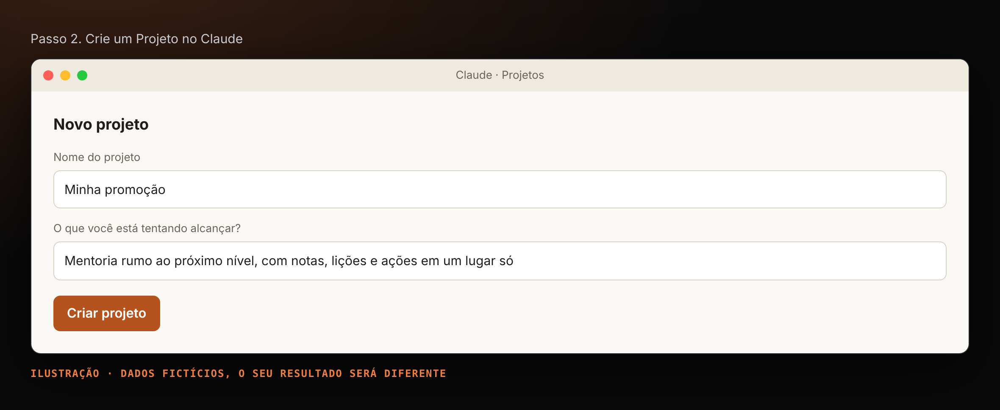

#### Passo 3. Envie os arquivos de apoio ao Projeto

Em **Conhecimento do projeto**, adicione:

| Arquivo | Por quê |
|---|---|
| `onboarding/questionario.md` | As perguntas da entrevista, com as opções dos botões |
| `modelos/painel.html` | O modelo visual do painel |
| Pasta `prompts/` | Só se você **não** instalou as skills |

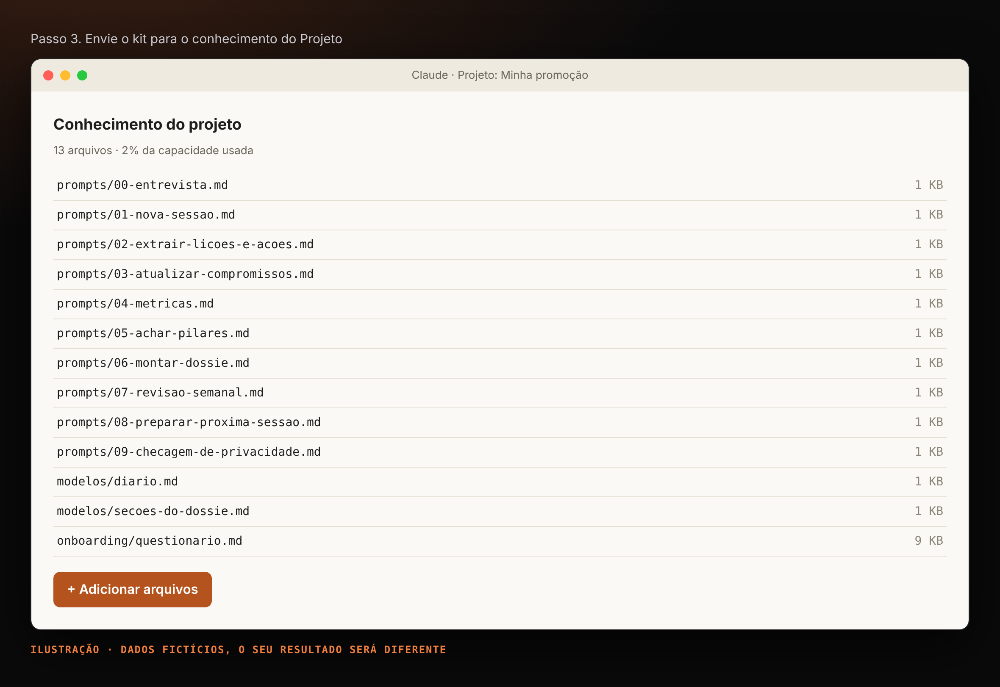

#### Passo 4. Faça a entrevista: `/liliai-entrevista`

Numa conversa **dentro do Projeto**, digite `/liliai-entrevista`.

1. **Privacidade (P1).** Sim ou não:
   - **Não, modo Anônimo** (padrão): tudo é anonimizado antes de ser registrado.
   - **Sim, modo Contexto**: o diário guarda nomes e números reais dentro do seu Projeto. Só vale se a política da sua empresa permitir; se a resposta do H3 contradisser, o Claude volta para Anônimo.
2. **Modo da entrevista (P2).** Você escolhe nos botões: **Rápido** (11 perguntas, cerca de 5 minutos) ou **Completo** (38, de 20 a 30 minutos). No rápido, o Claude pergunta no fim se você quer responder o resto agora ou depois; para completar mais tarde, diga "completar entrevista".
3. **Responda pelos botões** ou escreva no campo livre. Sem botões na sua versão, responda pelo número das opções.

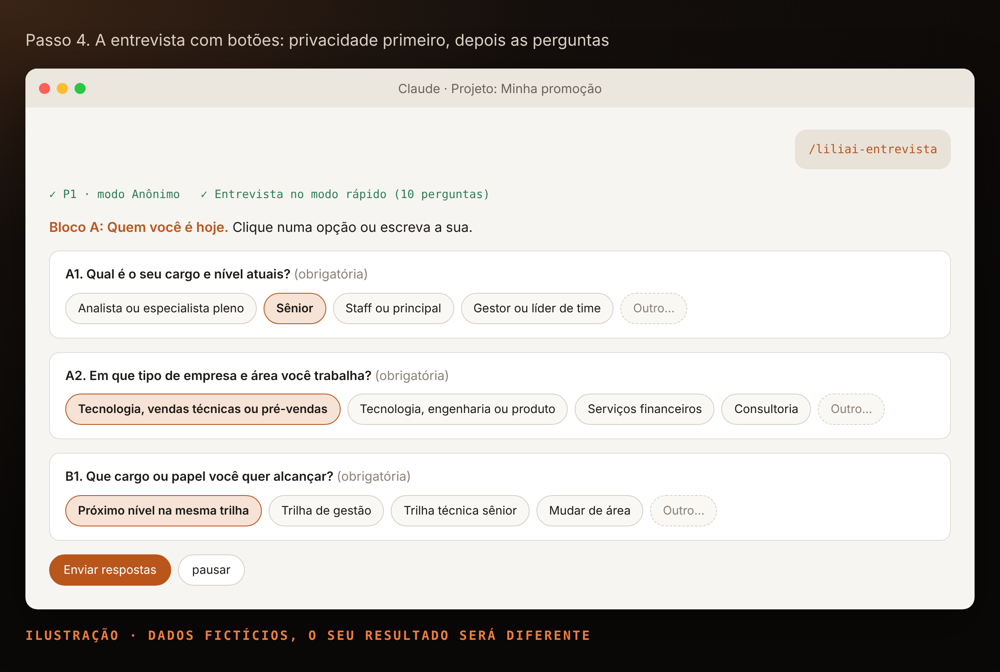

#### Passo 5. Receba os quatro itens

| Bloco | O que fazer |
|---|---|
| Resumo do contexto | Salvar no conhecimento como `contexto.md` |
| Instrução do projeto | Colar no passo 6 |
| Termos bloqueados | Nada: já estão na instrução |
| `diario.json` inicial | Salvar no conhecimento como `diario.json` |

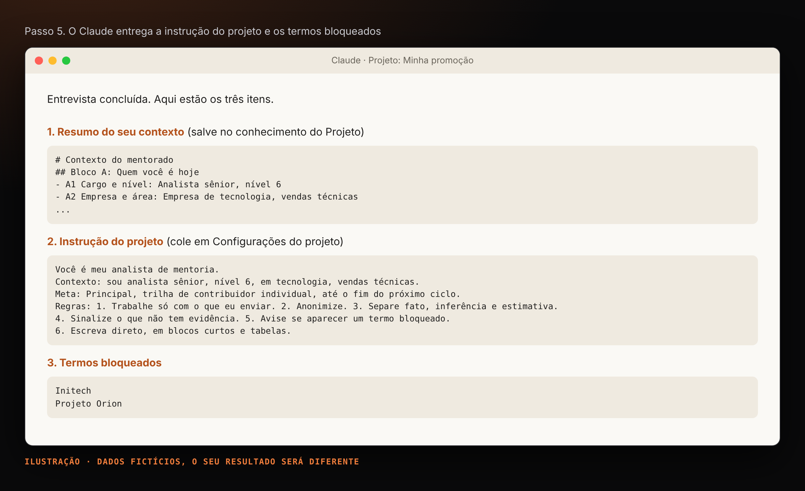

#### Passo 6. Cole a instrução

Copie a instrução para **Configurações do projeto > Instruções** e salve. Pronto: a montagem acabou.

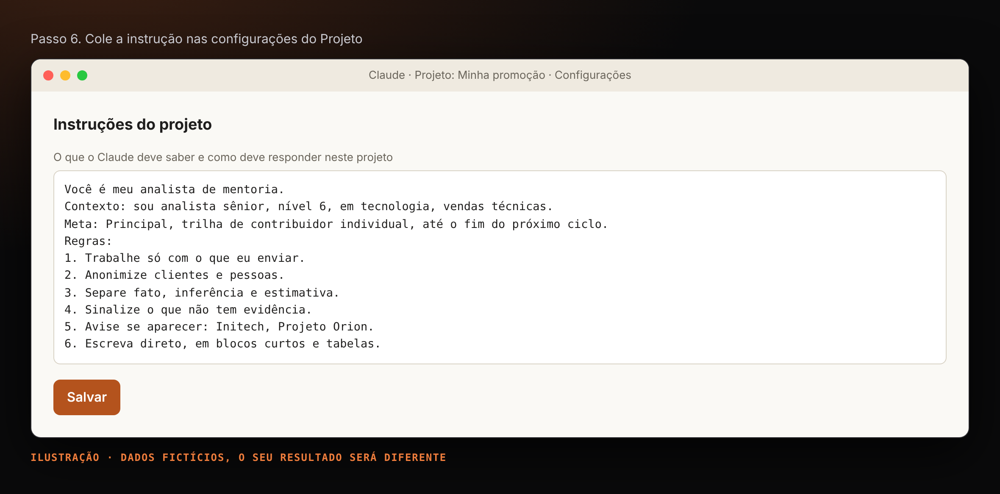

### Fase 2. Usar

#### Passo 7. Registre a sessão: `/liliai-sessao`

Logo depois da sessão, numa conversa do Projeto, envie numa mensagem só:

```text
/liliai-sessao
Data: 2026-10-09
Tema: Visibilidade com a liderança

[cole aqui as notas brutas ou a transcrição]
```

| Etapa | O que o Claude faz |
|---|---|
| Privacidade | Lista nomes, e-mails e valores. No Anônimo troca por funções; no Contexto mantém e avisa |
| Notas | Limpa o texto sem resumir nem inventar |
| Lições e ações | Extrai com ids, responsável, prazo e status, e marca inferências |
| Ações antigas | Atualiza o status quando as notas disserem |
| Evidências | Detecta quando quem decide leu, recebeu ou pediu algo seu |
| Métricas | Conta e confere a soma |

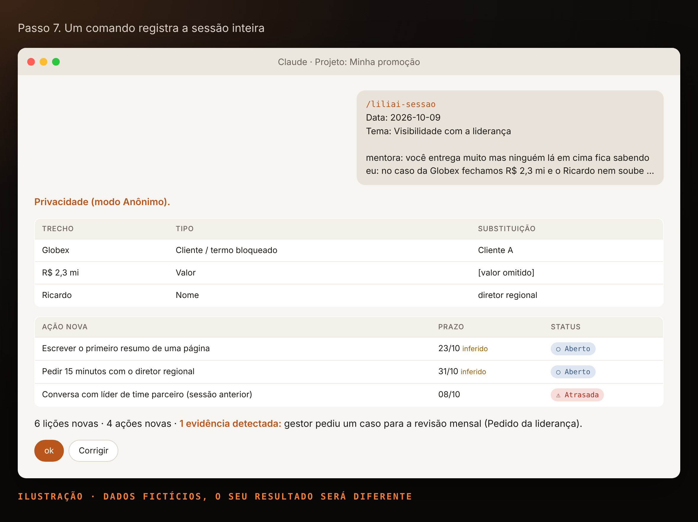

#### Passo 8. Confirme e substitua o diário

Responda **ok** ou corrija. O Claude devolve o `diario.json` completo: **substitua o arquivo no conhecimento do Projeto**. É o único passo manual, e leva dez segundos. Se o seu Claude edita documentos ou artefatos, peça para manter o diário lá e o passo some.

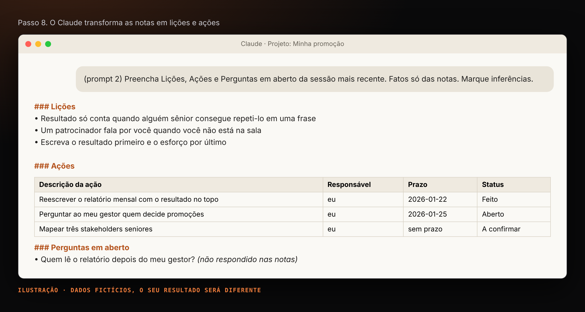

#### Passo 9. Registre evidências quando acontecerem

Algo aconteceu com quem decide entre uma sessão e outra? Uma linha:

```text
/liliai-sessao evidência: o diretor pediu meu resumo para levar ao comitê
```

| Tipo | Exemplo |
|---|---|
| Texto lido | O gestor leu e repassou seu resumo |
| Reunião com liderança | Você conseguiu 15 minutos com o diretor |
| Pedido da liderança | A diretoria pediu sua opinião ou um material |

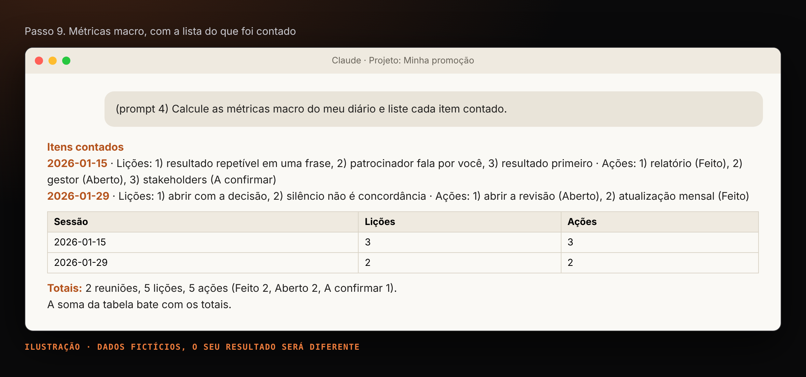

#### Passo 10. Antes de compartilhar: `/liliai-privacidade`

Cole o texto depois do comando. O Claude procura nomes, e-mails, valores, documentos internos e termos bloqueados, e devolve a versão reescrita. Vale nos dois modos.

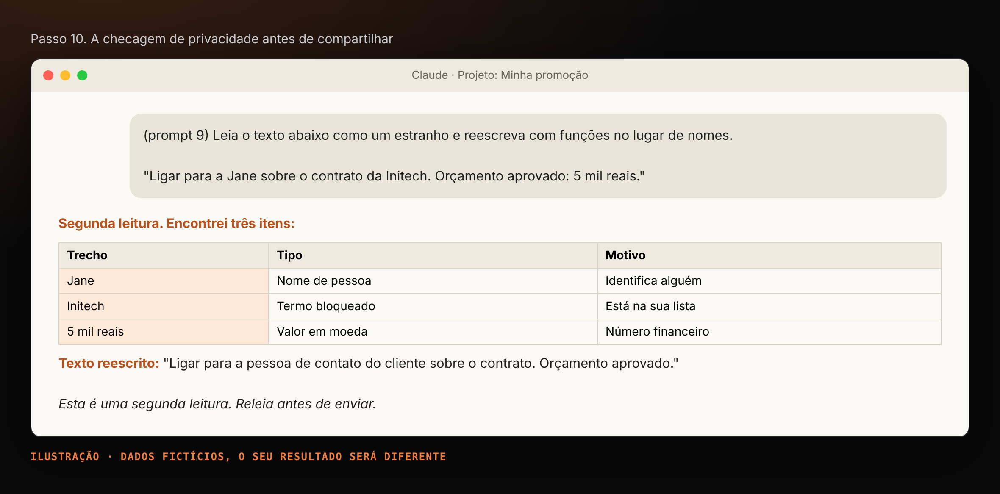

> A checagem é uma segunda leitura, não uma garantia. Releia antes de enviar.

#### Passo 11. Veja tudo num painel: `/liliai-painel`

O Claude pergunta se o painel é **para você** ou **para compartilhar** e gera uma página HTML a partir do `diario.json`:

| Bloco | O que mostra |
|---|---|
| Números | Sessões, lições, % concluídas, atrasadas, próximo prazo, evidências |
| Visibilidade | Evidências por tipo e as mais recentes |
| Gráficos | Ações por status e lições por sessão |
| Prioridade | A coisa mais importante agora e os próximos 30 dias |
| Compromissos | Todas as ações, com filtro e dias de atraso |
| Pilares | Temas que se repetem, ligados às lições por id |
| Histórico | Todas as sessões; as notas só aparecem na versão pessoal |

A versão **para compartilhar** troca nomes por funções, tira valores e notas e passa pela checagem de privacidade. Exemplos prontos: `exemplos/painel-normal.html`, `exemplos/painel-atrasos.html` e `exemplos/painel-vazio.html`.

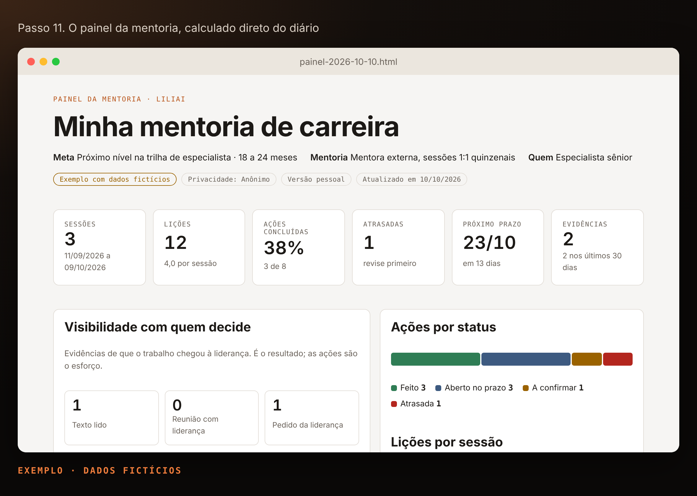

#### Passo 12. Toda semana: `/liliai-semana`

Dez minutos: o que vence e o que atrasou, botões para atualizar status, evidências da semana e a **pauta da próxima sessão** (três entregas, três perguntas, uma decisão). Se o seu Claude cria tarefas agendadas, a entrevista oferece agendar a revisão no seu horário.

### Sem skills? Use os prompts

Os prompts são gerados das skills e dão o mesmo resultado. Abra o arquivo, copie o bloco e cole na conversa do Projeto.

| Em vez de | Cole |
|---|---|
| `/liliai-entrevista` | `prompts/00-entrevista.md` |
| `/liliai-sessao` | `prompts/01-sessao.md` |
| `/liliai-semana` | `prompts/02-semana.md` |
| `/liliai-painel` | `prompts/03-painel.md` |
| `/liliai-privacidade` | `prompts/04-privacidade.md` |

## Demo para o seu grupo

A pasta `demo/` tem um cenário fictício completo (Rafa, especialista sênior de dados) e um roteiro de 20 minutos que passa por todos os comandos: `demo/ROTEIRO.md`. Para abrir, há um deck de 2 minutos com a fala de cada slide: `demo/abertura.html`.

## Privacidade em dois modos

| | Anônimo (padrão) | Contexto (com o seu sim) |
|---|---|---|
| O que fica no diário | Só funções, sem nomes nem valores | Dados reais, dentro do seu Projeto |
| Precisão do Claude | Boa | Maior |
| O que sai do Projeto | Anonimizado | Anonimizado, sempre |
| "Nunca registrar" (I1) | Nunca registrado | Nunca registrado |
| Este repositório | Nunca recebe dado seu | Nunca recebe dado seu |

Para voltar de Contexto para Anônimo, diga **"mudar para anônimo"**. Detalhes em `docs/04-privacidade.md`. O `.gitignore` já bloqueia `diario.json`, `contexto.md` e painéis gerados, para ninguém dar commit dos próprios dados num fork.

## Como funciona

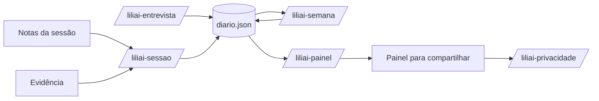

Todo comando lê e devolve o mesmo arquivo. Nada roda fora da conversa.

## Estrutura do kit

```text
LiliAI/
├── README.md                  você está aqui
├── index.html                 página do kit (GitHub Pages)
├── STATUS-QUO.md              níveis de maturidade de 0 a 4
├── skills/                    os cinco comandos (fonte única) e os zips em dist/
├── prompts/                   versão para colar, gerada das skills
├── onboarding/                questionário com opções de botão
├── modelos/                   diario.json vazio e painel.html
├── exemplos/                  três diários fictícios e seus painéis
├── demo/                      cenário fictício e roteiro de 20 minutos
├── docs/                      montagem, fluxo, privacidade, diário em JSON, dúvidas
├── scripts/build.py           gera prompts, anexos, zips e exemplos; confere a documentação
└── assets/screenshots/        as telas deste README
```

## Dúvidas comuns

**O `/liliai` não aparece.** Confira se os zips foram enviados e ativados na área de Skills. Sem Skills no plano, use os prompts.

**A entrevista veio sem botões.** Depende da versão do Claude. Responda pelo número das opções.

**O Claude esqueceu o meu contexto.** Abra a conversa dentro do Projeto e confira se a instrução está nas configurações.

**O painel mostra dados antigos.** Substitua o `diario.json` pela última versão que o Claude devolveu.

**Tenho um `diario.md` da versão anterior.** Deixe no Projeto e rode `/liliai-sessao`: ele converte para JSON.

Mais em `docs/06-solucao-de-problemas.md`.

## Contribuindo

Issues e pull requests são bem-vindos.

- A fonte de cada comando é `skills/<nome>/SKILL.md`. Não edite `prompts/` nem `skills/dist/`: rode `python3 scripts/build.py`.
- O CI roda `python3 scripts/build.py --check` e falha se prompts, zips, exemplos ou documentação estiverem desatualizados.
- Nunca coloque nomes, empresas ou números reais em exemplos.

## Licença

MIT. Veja `LICENSE`. As telas e exemplos usam dados fictícios.
